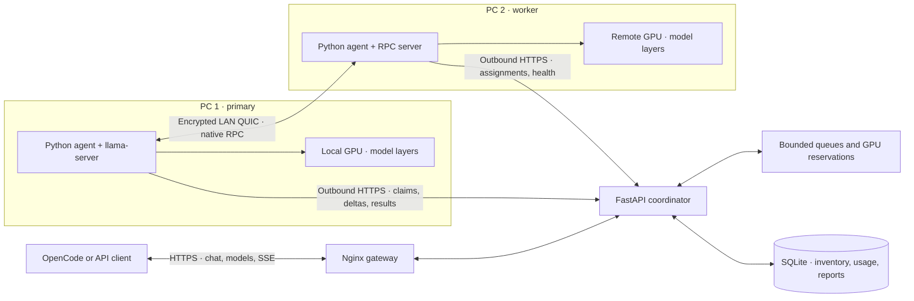
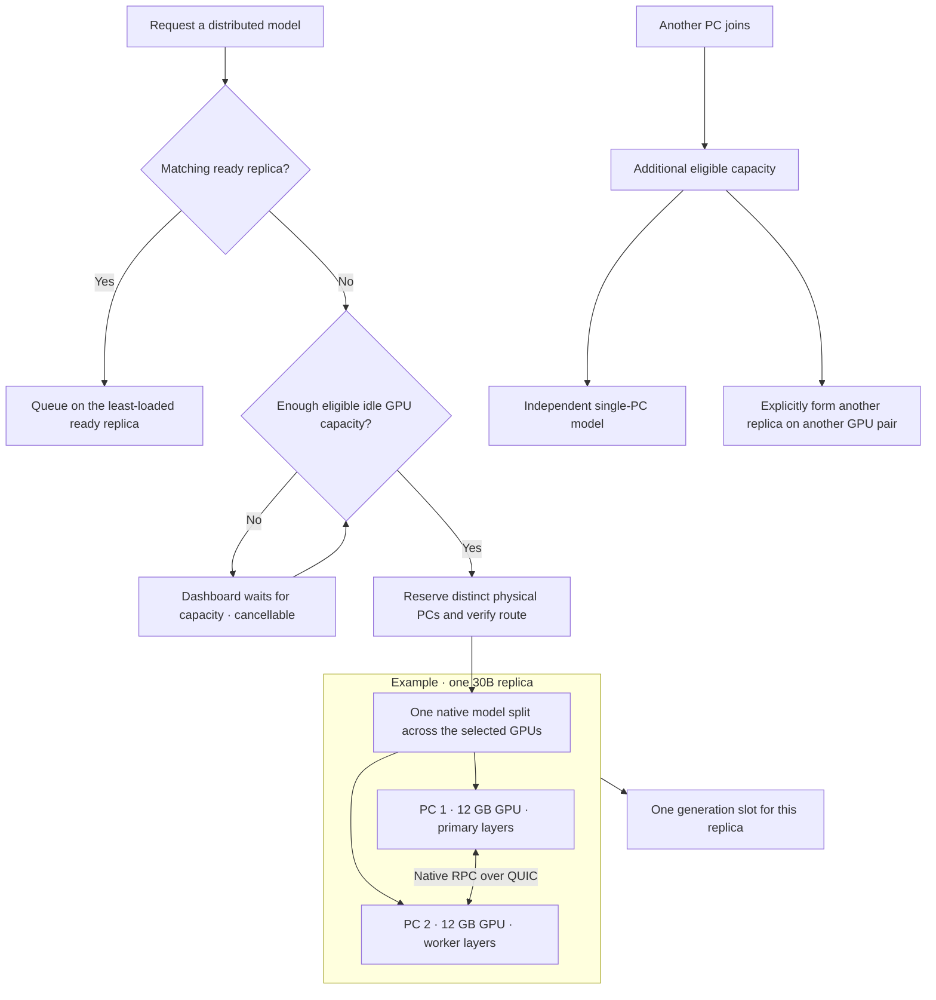

# PeerFoundry

Run language models across your own GPU machines, with one API and a dashboard
for model placement, worker health and inference requests.

PeerFoundry supports both **independent workers** for more simultaneous requests and
**distributed inference** for models too large for one GPU. A Python coordinator
owns scheduling; agents execute Ollama or llama.cpp on the worker machines.
OpenCode and other OpenAI-compatible clients use the same endpoint.

Built for individuals, students and educational labs that want to experiment with
open models using GPU computers they already have. Participating machines and
operators must trust one another; see the [security review](SECURITY.md) before
using shared equipment or sensitive data. Existing installations should read the
[rename and compatibility notes](docs/peerfoundry-rename.md).

## How it works



Agents initiate control connections, so the coordinator does not need to connect
inbound to each PC. When direct peer UDP works, reliable QUIC carries native RPC
between the GPUs without a separate relay or Windows administrator access.
Outbound HTTPS relays and private TCP are also supported. Connectivity is checked
before native model startup. The coordinator schedules work; it never executes
model layers.

## Multi-PC model allocation

For example, a 30B model can span two 12 GB GPUs. Exact fit depends on the model's
quantization, context, KV cache and available memory; adding reported VRAM is an
admission estimate, not a fit guarantee.



A third PC does not hot-join a running model or replace its members. It can serve
independent work; another GPU pair can serve a separate replica of the same model.
Ordinary requests prefer a ready replica with less pending work. Each physical
host has one workload reservation shared by chat, distributed inference, media
and container jobs, preventing those workloads from independently claiming it.

On two 12 GB GPUs, `qwen3:14b` and `qwen3:8b` each use one machine, while
`devstral-small-2:24b` can span both. Devstral also supports the ordinary Ollama
path when a larger single GPU can fit its requested context. See the
[Qwen3 and Devstral workflow](docs/opencode-setup.md#qwen3-and-devstral-on-two-12-gb-gpus)
for OpenCode defaults, model switching and exclusive capacity requirements.

More GPUs help models fit and can increase throughput. They do not necessarily
make an individual reply faster: layer splitting adds synchronization and network
traffic. See [performance controls](docs/performance.md) for repeatable comparisons.

## Features

- OpenAI-compatible model discovery and chat, including streamed reasoning, text
  and tool-call deltas from capable distributed agents.
- On-demand model download and loading, context admission, bounded queues and
  cancellation with claim fencing.
- Verified route selection: direct LAN QUIC, configured relays and coordinator
  relay fallback, with bounded recovery after teardown.
- Dashboard views for actual loaded models, replica state, download progress,
  GPU-memory allocation and retained failures.
- Per-user Windows configuration, watchdog supervision and idle self-updates.
- OpenCode setup with live model discovery and optional title-only routing to a
  spare worker, plus isolated read/edit/test checks.
- Optional Docker batch and media workers, and disposable Terraform GPU/relay labs.

## Run the coordinator

Requirements: Docker with Compose and Python 3 for the setup/client helpers.
GPU agents need compatible installed drivers; the direct QUIC path requires
Python 3.11 or newer on the agents.

```sh
make init       # Creates private .env with fresh keys; preserves an existing file
make up
```

Open **http://127.0.0.1:8081/peerfoundry/** and sign in with the admin key from `.env`.
Use `make status` and `make health` to inspect the stack. The coordinator and UI
ports remain inside Docker; the gateway binds to loopback.

To connect other PCs, provide an HTTPS deployment URL reachable from them.
[The nginx example](nginx/peerfoundry.conf.example) forwards `/peerfoundry/` to the gateway.
The UI derives its join commands and API banner from the current browser origin.
Keep deployment-specific URLs and credentials in ignored `.env`/`.env.opencode`
files; optional private gateway routes belong in ignored `nginx/local.d/`.

| Endpoint | Purpose |
| --- | --- |
| `/peerfoundry/` | Dashboard |
| `/peerfoundry/api` | Agent control API |
| `/peerfoundry/api/v1/models` | Current model catalog |
| `/peerfoundry/api/v1/chat/completions` | OpenAI-compatible chat |
| `/peerfoundry/api/healthz` | Health check |

## Connect GPU agents

Use the dashboard's platform-specific join command, or download the supplied
Python agent from your deployment:

```sh
export PEERFOUNDRY_URL=https://peerfoundry.example.com/peerfoundry
export PEERFOUNDRY_AGENT_KEY=your-agent-key
curl -fsSL "$PEERFOUNDRY_URL/agent/agent.py" -o agent.py
python3 agent.py --coordinator "$PEERFOUNDRY_URL/api" --api-key "$PEERFOUNDRY_AGENT_KEY"
```

On Windows, use the PowerShell/CMD command shown in the dashboard. The agent
prepares its per-user runtime and reports progress. A distributed request forms
its native cluster when enough eligible GPUs are available. The dashboard can
[wait through reconnection and setup](docs/ui-startup-wait.md); a cold download
or model load can take several minutes.

The reviewed sources are included in [`agents/`](agents/README.md). No personal
repository or external agent checkout is required to serve them.

## Use OpenCode

```sh
python3 scripts/setup-opencode.py --install --base-url https://peerfoundry.example.com/peerfoundry/api/v1
python3 scripts/run-opencode.py
```

Replace the example URL with your deployment and enter its consumer key when
prompted. Use `py -3` on Windows. Setup installs the pinned CLI locally, discovers
available models and preserves other providers. The checked-in profile references
environment variables; deployment URL and prompted key are saved privately.

Choose a PeerFoundry model with `/models`, then send a request. Model downloads and
startup happen on demand. [The client guide](docs/opencode-setup.md) covers
refreshing the catalog, switching models, context and optional title routing.

## Verification

```sh
uv run --python 3.12 --with-requirements coordinator/requirements.txt \
  --with requests --with httpx --with aioquic==1.7.0 \
  python -m unittest discover -s tests -p 'test_*.py'
npm ci --prefix ui
npm test --prefix ui
npm run build --prefix ui
python3 scripts/rpc-stream-smoke.py
python3 scripts/opencode-smoke.py
```

The Python suite exercises scheduling, claims, queue limits, teardown, transport
faults and streaming. UI tests cover machine/replica presentation and startup
waiting. The final two commands use actual available agents; the OpenCode check
reads, edits and tests a disposable coding fixture. Private results and work
journals remain outside Git.

## Boundaries and tradeoffs

- The current direct QUIC adapter connects exactly two capable private-IPv4 agents.
  Other supported native transports can use multiple workers.
- Live cluster membership and context are fixed at startup. Model switches and
  larger contexts may require idle teardown; workloads are not silently evicted.
- Chat queues and active streams are in memory. Unexpected coordinator restarts
  lose those sessions. Planned idle QUIC handoff preserves native processes;
  it does not transfer in-flight requests or HTTP relay buffers.
- Partially streamed responses cannot be automatically replayed. GPU reservations
  stay held until completion or acknowledged teardown.
- GPU allocation is memory telemetry, not compute utilization. Reported VRAM
  does not account for every external application or guarantee native fit.
- RPC and container workers belong on trusted hosts/networks; this is not a
  hostile multi-tenant execution boundary.

## Project map

| Directory | Responsibility |
| --- | --- |
| `coordinator/` | API, admission, scheduling, claims, transport control and streaming |
| `agents/` | Python/PowerShell workers and the QUIC adapter |
| `ui/` | React/TypeScript dashboard |
| `scripts/` | Client setup, health checks, trials and deployment helpers |
| `tests/` | Coordinator and agent regression scenarios |
| `infra/` | Optional disposable AWS GPU lab and budget relay module |
| `docs/` | Architecture, setup, operations and performance guides |

Start with [architecture](docs/architecture.md),
[coordinator modules](docs/coordinator-modules.md),
[Qwen3.8-27B setup](docs/qwen38.md),
[distributed inference](docs/distributed-inference.md),
[routing](docs/relay-routing.md) or [dashboard behavior](docs/controller-dashboard.md).
The [AWS lab](infra/rpc-lab/README.md) and [optional relay](infra/relay/README.md)
are Terraform-owned experiments with explicit cleanup; starting the local stack
or client does not create cloud resources. Cloud relay use is disabled by default.
