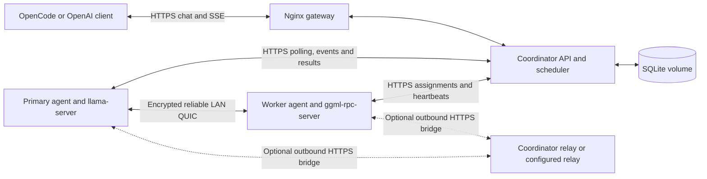

# Architecture and component ownership

This guide describes the implementation and supported behavior. Dated reports
and trial observations are retained locally in ignored `.journal/`; they are not
a live inventory or a dependency of these guides. See
[30B performance configuration](performance.md) for tuning and verification.

## Request and inference paths

The coordinator owns model policy, admission, claims, assignments and response
delivery. Agents initiate control connections and execute inference. For ordinary
single-machine work an eligible agent runs Ollama. For a catalog distributed
model the primary runs llama-server and remote workers expose native RPC to the
selected transport. The coordinator never executes model layers.

Direct LAN QUIC avoids a separate relay machine when peer UDP works. This is a
reliable encrypted byte transport for native RPC, separate from model downloads
and HTTP response streaming. It requires two capable private-IPv4 agents and no
Windows administrator privileges. Direct TCP and outbound HTTPS relay paths
remain available. The current deployment uses automatic route selection with
cloud relays disabled; enabling cloud infrastructure is a separate configuration
and Terraform operation.

## Implementation boundaries

| Component | Responsibility |
| --- | --- |
| `coordinator/coordinator.py` | Authenticated API, worker inventory, physical-host reservations, replica scheduling, claim/result fencing and orchestration |
| `coordinator/api_models.py`, `models.py` | Typed HTTP payloads and machine/job entities without scheduler globals |
| `coordinator/security.py` | Three-role API-key authentication, client identity and request rate limits |
| `coordinator/persistence.py` | SQLite migrations, inventory/media recovery, usage recording and aggregation |
| `coordinator/catalog.py`, `placement.py` | Model estimates, context policy, physical-host eligibility and fair GPU selection |
| `coordinator/admin_api.py` | Inventory and usage endpoints wired to explicit repository and runtime dependencies |
| `coordinator/validation.py`, `schemas/` | Cached Draft 2020-12 JSON Schema validation for untyped client/agent inputs |
| `coordinator/chat_admission.py` | Request validation and normalization without network I/O |
| `coordinator/relay_policy.py` | Candidate coverage, network affinity and failed-route cooldowns |
| `coordinator/quic_control.py` | Immutable peer endpoint exchange and cluster-scoped QUIC trust material |
| `coordinator/relay_transport.py` | Bounded ordered binary channels for the local HTTP relay |
| `coordinator/relay_client.py` | Async coordinator client for the private Terraform provisioner |
| `coordinator/relay_server.py` | Standalone relay service using the same channel protocol |
| `coordinator/relay_provisioner.py` | Host-side Terraform apply/destroy, readiness, leases and deadline cleanup |
| `scripts/relay-provisioner.py` | Launcher and single-instance lock for the optional provisioner on the existing host |
| `coordinator/chat_stream.py` | Bounded event ingestion, sequence checks, claim validation and SSE chunk normalization |
| `coordinator/rpc_performance.py` | Allowlisted native settings and model-specific configuration validation |
| `coordinator/rpc_handoff.py` | One-use validation and restoration of idle QUIC cluster metadata |
| `agents/agent.py` | Per-user installation/watchdog, model and runtime setup, workload execution, reporting, RPC roles and incremental result publication |
| `agents/quic_transport.py` | Peer TLS verification, reliable QUIC streams and bounded native TCP adapters |
| `ui/src/MachineActivity.tsx`, `ui/src/machine-state.ts` | Runtime-derived loaded models, replica state, download progress and GPU-memory presentation |
| `ui/src/chat-request.ts` | Cancellable, bounded waiting for explicitly rejected GPU capacity; no automatic replay of accepted inference |
| `scripts/setup-opencode.py`, `gen_opencode_config.py`, `run-opencode.py` | Live model discovery, client configuration and private credential loading |

These modules keep transport, validation, persistence and placement policy behind
explicit boundaries. The API process owns scheduling state and reservations;
module extraction does not change queue durability or create additional services.
See [coordinator modules and schema contracts](coordinator-modules.md) for the
dependency rules and validation workflow.

## Scheduling and resource ownership

A worker's stable identity and physical-host slot prevent chat, RPC, media and
container workloads from independently reserving the same machine. Downloads
for a claimed job also hold that reservation. Stale registrations and repeated
polls do not create additional physical capacity. Single-machine model and
context policies gate discovery and claims; explicit model requests are not
silently replaced with smaller models.

RPC jobs carry a replica ID as well as the public model name. Ordinary requests
prefer a ready replica with the least pending work. Explicit admin-pinned requests
can form another replica on an exact pair. Each primary claims only its replica's
jobs. Joining machines do not replace active members, create replicas automatically
or rebalance a running model. Older queued single-machine demand retains eligible
capacity during new RPC selection.

The catalog distinguishes native-only models from models with an optional native
fallback. `devstral-small-2:24b` prefers an eligible single-GPU Ollama worker; if
none can fit its requested context, admission uses the distributed path. An
existing matching native replica is reused. Jobs bind to the chosen execution
path: ordinary agents cannot claim distributed work, and native primaries cannot
claim unbound ordinary work for the same model. Recovery retains native ownership;
dissolving a replica does not cancel independent Ollama jobs. Both paths preserve
the requested model. On two 12 GB GPUs, Devstral reserves the pair and Qwen3 models
wait until it is released.

Native Devstral uses a separately cached text Q4_K_M artifact, pinned to a
publisher revision and checksum. The agent streams it to a temporary file with
disk-space and size bounds, and promotes it only after hash verification. It does
not pass Ollama's combined text/vision blob to the upstream native text loader.
Other native models retain Ollama-blob reuse; single-device Devstral still uses
the original Ollama library package.

Claims carry attempt tokens. Late results, old teardown acknowledgments and lost
claim-response retries cannot overwrite a newer attempt or free its reservation.
Cancellation fences the logical job immediately, while the physical reservation
remains held until matching completion or native teardown is acknowledged.
Queue admission is bounded at eight waiting jobs per model and 64 globally;
excess submissions receive HTTP 429 with `Retry-After`.

The [dashboard startup wait](ui-startup-wait.md) retains the prompt locally when
RPC capacity is explicitly rejected, then retries until enough GPUs are eligible.
Accepted requests remain pending through setup and inference without duplicate
submission. Other errors and unknown network outcomes are not retried automatically.

Automatic routing proves an end-to-end challenge before model download/native
startup. Failed routes enter cooldown and may recover through another eligible
route, within the original request deadline and bounded retry count. Native
sockets cannot migrate: agents must tear down before replacement work begins.
See [distributed inference](distributed-inference.md), [routing](relay-routing.md)
and [agent reporting](agent-failure-reports.md) for operational details.

## Incremental delivery and tuning

Updated RPC primaries advertise streaming capability, read native SSE, and send
ordered event batches through the authenticated control API. Upload work runs
separately from native stream reading. Both agent and coordinator queues are
bounded; slow consumers apply backpressure. Identical upload retries are
idempotent, while changed duplicates, reordered batches and stale claims fail.
Text, reasoning and fragmented indexed tool calls retain their semantics.

The coordinator forwards deltas immediately and emits final finish/usage only
after accepting the fenced result. It tracks still-draining responses so an
administrative idle stop or deployment cannot mistake them for idle work.
Disconnects cancel inference; a partially emitted response cannot be replayed
automatically. Older agents and the single-machine Ollama path retain their
completed-response fallback.

`RPC_MODEL_RUNTIME_PROFILES` configures only named models. Its validated settings
are batch size, microbatch size and RAM prompt snapshot capacity; it cannot alter
weights, reasoning or context. The measured 30B deployment disables snapshots
and keeps batch/microbatch at 128/64. Normal running-slot prefix reuse remains
enabled. Larger tested batches regressed the full workload and were not adopted.
The OpenCode title-only override uses the spare machine; coding and summary
requests retain 30B and the 32K client profile. See
[configuration and tradeoffs](performance.md) and
[OpenCode setup](opencode-setup.md).

## Persistence and deployments

SQLite on the existing coordinator volume retains machine inventory, usage,
failure reports and supported batch/media job records. Chat queues, live claims,
HTTP connections and stream buffers remain in memory. An unexpected coordinator
crash does not preserve synchronous chat sessions. RabbitMQ was evaluated but
has not been deployed; see [durable job prerequisites](queue-durability.md).

`scripts/deploy-quic-handoff.py` supports a planned coordinator update with active
but idle direct QUIC clusters. It drains jobs and streams, closes admission
briefly, writes a protected short-lived one-use snapshot, then verifies cluster
and native process identities after restart. Agents retain native processes and
QUIC sockets. In-flight requests and HTTP relay buffers are not transferred.
Invalid snapshots fail validation before any restoration.

Agents report retained failures, current source revision, watchdog status,
process IDs and bounded native logs. Updates wait for idle roles and jobs, with a
second activity check before replacement. GPU allocation is memory telemetry,
not compute utilization. See [agent reporting](agent-failure-reports.md) and
[dashboard semantics](controller-dashboard.md).

## Repository and infrastructure ownership

`agents/` contains the reviewed source needed by a fresh checkout. Both public
agent downloads and the coordinator's authenticated source endpoint use the same
read-only mounted directory. The Python agent pins its QUIC helper by SHA-256;
see [agent source checksums](agent-source.md). The GPU lab's captured snapshot is
intentionally separate from the current agent.

`infra/rpc-lab` owns the disposable real-GPU experiment and `infra/relay` owns the
optional budget relay. Terraform owns their cloud resources; neither documentation
nor client setup applies either module. Cloud relay use is currently disabled and
the earlier resources were destroyed. Keep Terraform state/private inputs for
verified cleanup, outside Git. Runtime installers in `mirror/`, private keys,
client credentials and `.rpc-trial/` evidence are also excluded from Git.

## Validation

Coordinator/agent regressions exercise admission, claims, recovery, transport
faults, streaming and cancellation. UI tests exercise runtime presentation and
the restart-wait flow. The [performance guide](performance.md) describes public
SSE and isolated OpenCode read/edit/test checks. UI build and Terraform validation
commands live in their respective guides; these checks do not provision cloud
resources. Dated results, exact timings and environment-specific limitations
belong in the ignored work journal.
