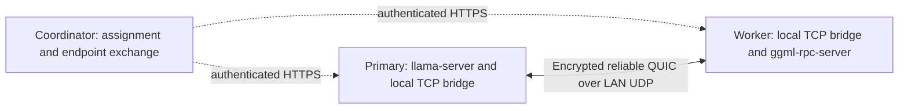

# Direct LAN inference over QUIC

The Python agent supports native llama.cpp RPC over encrypted, reliable QUIC
between two machines. This avoids an external data relay when ordinary inbound
LAN TCP is blocked but simultaneous peer UDP succeeds. It runs as the existing
user without administrator access, a virtual network adapter or firewall changes.

The first implementation supports exactly one primary and one worker, both with
private IPv4 addresses and Python 3.11 or newer. Other agents and relay routes
continue using their existing transport. QUIC capability is reported in agent
heartbeats; older agents cannot be assigned this route.
The [scheduler](architecture.md#scheduling-and-resource-ownership) supports
independent two-machine replicas with separate queues/claims and shared model naming.

## Request the route

On a fresh cluster, send `rpc_transport: "quic"` with the existing model request:

```json
{
  "model": "qwen3:30b-a3b",
  "rpc_transport": "quic",
  "messages": [{"role": "user", "content": "Explain your solution."}],
  "options": {"num_ctx": 32768},
  "stream": false
}
```

The coordinator keeps its existing physical-host reservations, GPU admission,
model, context, queue and idle-lifetime rules. QUIC does not change weights,
quantization, reasoning, tensor contents or context size. An explicit QUIC
request cannot silently reuse an existing relay cluster: it receives HTTP 409
until that cluster has completed teardown.

Run the real two-machine trial from the coordinator host:

```sh
python3 scripts/rpc-trial.py --transport quic --context 32768 \
  --hosts GPU-NODE-01 GPU-NODE-02 --wait-seconds 900
```

It waits for safely updated, idle agents, runs cold and warm inference checks,
verifies the requested route and pair, checks both QUIC byte counters and GPU
allocations, and saves private evidence below `.rpc-trial/`.
For QUIC it sends `rpc_agent_ids` with the selected pair, using the admin key.
This optional admin-only field prevents newly joining GPUs from being selected
instead; busy, offline or incapable selected agents are never replaced silently.

## Connection and trust



Each agent binds an OS-assigned LAN UDP port. The coordinator exchanges these
ports using the existing authenticated agent API and registered LAN addresses.
Both peers send small UDP keepalive packets from the same socket to establish
stateful firewall mappings. The native RPC servers remain bound to loopback.

The worker generates a temporary TLS certificate and private key in memory. Its
public certificate reaches the primary through the coordinator's authenticated
channel. The primary requires TLS verification against that exact certificate
and the `swarm-rpc` hostname; certificate checks are never disabled. Every RPC
stream also requires a random token unique to that cluster. Incoming UDP is
restricted to the assigned peer address and port. Endpoint registration cannot
change during a cluster, and dissolved assignments are rejected.

`aioquic==1.7.0` provides QUIC's encryption, ordered streams, retransmission and
congestion control. On first use, the agent installs binary wheels into a
private per-user directory. It fetches `agent/quic_transport.py` through the
existing download route and requires the SHA-256 pinned in its own source.
System Python packages are not changed. Dependency installation failures use
the normal durable agent failure-report path.

The adapter allows at most eight native streams and four unacknowledged chunks
per direction per stream, plus one locally read chunk. Updated peers negotiate
`swarm-rpc-v2` using TLS ALPN for chunks up to 256 KiB; either older peer selects
the original `swarm-rpc-v1` profile with 64 KiB chunks. Thus each direction's
application window is bounded at 1 MiB for v2 or 256 KiB for v1. Acknowledgement
follows writing to the peer's native socket. This bounds buffering independently
of the library's stream writer. TLS keys and tokens are excluded from public
cluster status; per-agent byte counts, connection state and peak in-flight
chunks are available in `quic_stats`.

## Failure and lifecycle

An explicit QUIC trial fails visibly if installation, endpoint discovery, TLS,
stream authentication or direct UDP connectivity fails. A transport failure
closes local streams and flows through existing role teardown and crash reports.
Endpoint updates run off the QUIC event loop; loss of the coordinator control
channel for over 45 seconds ends the tunnel. Normal role teardown closes UDP
sockets, loopback listeners and stream tasks before releasing the GPU reservation.
For cold starts, a worker publishes readiness without waiting for the primary's
GGUF download and stays available within the bounded 1,800-second formation
window. The QUIC primary allows at least 1,800 seconds for native model loading;
first-time worker tensor-cache fills can exceed the older 900-second allowance.

There is no migration of an active native RPC connection onto a relay. After
teardown, a new request can use the existing Spanish/coordinator relay transport.
The [automatic routing policy](relay-routing.md) now checks LAN QUIC, eligible
relay candidates and the coordinator fallback before model startup. Cloud relay
use is currently disabled. Explicit transport trials retain their chosen route.

This route creates no AWS resources. Existing Terraform-managed relay cleanup
continues to be owned by the provisioner.

## Verification

Run the pinned-pair trial above and verify the requested route, full GPU layer
offload, expected context and byte counters from both agents. Transport tests
exercise packet loss, reordering, duplication, half-close, bounded buffers,
certificate/token checks, endpoint immutability and teardown. Retain dated live
results and screenshots in ignored `.journal/` and `.rpc-trial/` directories.
