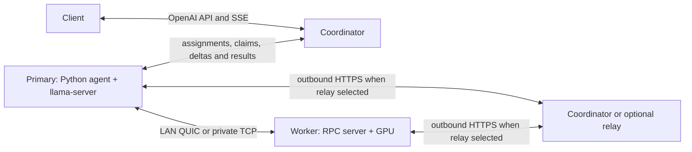

# Distributed inference

Swarm supports two different ways to use several machines:

- Ordinary Ollama jobs are pulled by independent agents. Each machine loads its
  own model; this increases request capacity.
- RPC clusters use llama.cpp to distribute one model across local and remote
  GPUs. This makes models that exceed one GPU's memory possible.

The coordinator is a scheduler and result relay. It does not execute model
layers. Docker batch jobs and image/video jobs are separate features.
The [component guide](architecture.md) describes module boundaries and deployment
ownership. Dated trial reports are retained locally in ignored `.journal/`.

## Request lifecycle

1. Agents register their GPU memory, stable ID, and LAN address, then poll
   `/agent/rpc/assignment` every five seconds.
2. `POST /v1/chat/completions` for a catalog RPC model calls
   `_form_rpc_cluster` in `coordinator/coordinator.py`.
3. Existing ready replicas are preferred, with queued requests included in their
   load. New clusters reserve distinct physical hosts with enough reported VRAM,
   respecting older queued single-machine demand. Automatic two-machine routing
   considers network affinity and proves the route before native startup.
   Admin-pinned requests preserve their exact machine identities. A sufficiently
   large GPU can also serve a native cluster without remote workers.
4. Direct workers receive ports starting at `50052`; the primary receives their
   LAN endpoints. Relay workers and primary relay listeners instead select
   available loopback ports locally, and the primary passes its actual listener
   endpoints to llama-server. The primary also selects an available loopback
   HTTP port, avoiding fixed ports that Windows may reserve. Context is fixed at startup;
   the first request can set `options.num_ctx` between 512 and 32,768. New
   `qwen3:30b-a3b` clusters default to 32,768; other RPC models default to 4,096.
5. Agents pause ordinary Ollama work. Workers start RPC servers; the primary
   resolves the model's GGUF from its Ollama manifest and blob cache, pulling it
   first when missing. It stops managed Ollama or unloads models from an adopted
   server, then starts llama-server with `--rpc`, memory mapping, quantized KV
   cache, and automatic GPU fitting with 512 MiB headroom per device.
6. The primary reports `/agent/rpc/ready`, claims only its replica's queued jobs,
   translates the request to native OpenAI format, and submits a fenced result.
   Updated primaries also publish incremental events for streamed requests.
7. The coordinator signals dissolution after the configured idle window (five
   minutes by default; 15 minutes in the restored Spain deployment). Agents terminate
   llama.cpp, report `/agent/rpc/done`, and restart Ollama. Formation and consumer
   waits have a 30-minute timeout, extended to 60 minutes for relay transport.

The client-facing API accepts OpenAI-style requests. Updated RPC primaries stream
reasoning, text and indexed tool-call deltas through bounded authenticated event
uploads. The coordinator forwards SSE and commits finish/usage only with the
accepted final result. Single-machine Ollama and older agents retain completed
response streaming. See [streaming and tuning](performance.md).

## Single-response speed without reducing model quality

GPU compute utilization alone does not measure available decoding speed. With
layer splitting, one token passes through layers on different machines in
sequence; memory access and network synchronization can leave a GPU waiting.
More machines increase capacity but also add communication. Compare native
generation tokens/second and request latency with the same model, quantization,
context, prompts, and reasoning behavior before changing hardware.

The relay bridge disables Nagle buffering on both local TCP hops. The native
runtime already disables it on its own sockets. Byte ordering, retransmission,
and bounded buffers are unchanged.

Model-free n-gram speculative decoding was tested with the pinned runtime,
but it slowed the matched warm response and changed the reasoning token count.
It was removed from the deployed path. Detailed trial observations and evidence
identifiers are retained in the private work journal.

## Current catalog

These are configured admission estimates, not guaranteed footprints:

| Identifier | Combined reported VRAM required |
| --- | ---: |
| `qwen3.6:27b` | 17 GB |
| `qwen3:32b` | 20 GB |
| `qwen3:30b` | 19 GB |
| `qwen3:30b-a3b` | 19 GB |

The table describes the repository's identifiers; availability of each upstream
model is a separate requirement. The estimates do not account for exact
quantization, free GPU memory, KV cache, or other applications using the GPU.
Adding a larger model requires extending `_RPC_MODELS`, preparing its GGUF, and
checking that context and device buffers fit. There is no general RAM-pooling
feature in the Swarm scheduler.

## Network and machine requirements

- [Direct LAN QUIC](direct-quic-inference.md), selected with `rpc_transport: "quic"`,
  carries reliable, encrypted RPC between two updated Python agents when peer
  UDP works without inbound TCP. It requires no administrator access or cloud
  relay; an explicit trial preserves the existing default routing policy.
- With `rpc_transport: "direct"`, the primary must reach every worker's assigned TCP port. All workers being
  able to reach the coordinator is insufficient. University Wi-Fi isolation,
  NAT across sites, and unrelated private networks can prevent RPC connections.
- Set top-level `rpc_transport: "relay"` on the first model request when direct
  connectivity is blocked. Both Python agents make authenticated outbound HTTPS
  requests to the coordinator; the native worker and primary relay listeners
  bind to loopback. No Windows administrator privileges or inbound firewall
  rule are needed. The coordinator forwards model tensors and RPC messages,
  so its bandwidth and latency affect loading and generation. It still does
  not execute model layers.
- A Terraform-managed [relay](../infra/relay/README.md) can carry
  model bytes near the campus while the existing coordinator schedules jobs.
  The optional [local provisioner](relay-provisioning.md) lets the
  coordinator create the relay on first multi-GPU demand and destroy its
  Terraform resources after idle use. AWS credentials stay on the existing
  provisioner host. Provisioned clusters use the returned control key and
  deadline; static relay configuration below remains supported.
  `RPC_RELAY_URL` selects this endpoint for new relay clusters; updated Python
  agents receive it in their assignments. `RPC_RELAY_ADMIN_KEY` controls remote
  membership and leases. `RPC_RELAY_EXPIRES_AT` stops selecting the temporary
  endpoint shortly before its budget deadline. The local relay remains the
  fallback when no eligible regional endpoint is available.
- The current deployment sets `RPC_DEFAULT_TRANSPORT=auto`: it tries verified
  LAN QUIC, eligible configured relays and the coordinator relay. Cloud selection
  requires `RPC_CLOUD_RELAY_ENABLED=true`; it is disabled on this deployment.
  `direct|relay|quic` explicitly selects a transport. If the environment setting
  is omitted, the compatibility default remains relay when configured and direct
  otherwise. An explicit request overrides the default for new clusters.
  See [route policy and recovery](relay-routing.md).
- Keep RPC inside a protected network. Upstream describes RPC as experimental
  and warns against open-network exposure. The Swarm API keys do not authenticate
  the llama.cpp RPC transport.
- Use matching llama.cpp revisions compiled with `GGML_RPC=ON` and an appropriate
  accelerator backend on every node. Current upstream calls the RPC executable
  `ggml-rpc-server`.
- The Python primary downloads missing model weights automatically. Pre-pulling
  avoids a cold download during the first request. Remote workers
  receive tensors from the primary rather than loading a separate full model.
- Plan for primary RAM, storage, model load time, and network transfer. Combined
  VRAM is a capacity check; it does not promise faster token generation.

For example, two 12 GB GPUs pass the 20 GB admission threshold for `qwen3:32b`.
That does not establish that a large context will fit in their actual
free memory. Check llama.cpp device allocation logs and GPU memory use.

## Known limitations in the application

The current Python implementation addresses the original review and subsequent
campus trials. Remaining limitations are:

1. The separate legacy `llama-rpc.ps1` still expects `llama-rpc-server`. Python
   now uses `ggml-rpc-server`, pins the shared `b11612` revision, and installs
   both Windows CUDA 12.4 binary and runtime archives using direct URLs, avoiding
   university NAT GitHub API rate limits. Its Linux installer still assumes ZIP
   assets and does not reliably select a CUDA build.
2. Python now resolves `%USERPROFILE%/.ollama/models` and honors `OLLAMA_MODELS`.
   It does not discover a separate Linux service account's model store or an
   externally managed server's differently configured storage.
3. Address affinity is only a candidate ordering hint; actual preflight checks
   determine connectivity. Model files may still require downloading or fail to
   load. Reported total VRAM is an admission estimate rather than a free-memory
   guarantee. Direct QUIC currently supports exactly two capable private-IPv4
   agents; larger clusters need another supported transport.
4. Role failures retain native logs and use assignment/claim fencing during
   teardown. Automatic routes have bounded retries after old reservations are
   released, but cannot migrate live native sockets. Partially streamed responses
   cannot be replayed automatically. In-memory jobs and consumer connections
   do not survive unexpected coordinator restarts.
5. `/v1/models` excludes busy/reserved workers from RPC capacity, but its
   availability snapshot can still change before admission. Same-model replicas
   are supported through explicit admin-pinned formation; adding a GPU does not
   automatically create another replica or rebalance a running model.
6. Chat, media, container, and RPC claims now share a workload slot. Model
   downloads happen after job claims, retried chat attempts use claim tokens,
   and context eligibility accounts for single-device policy limits. See the
   [scheduling guide](architecture.md#scheduling-and-resource-ownership) for
   scenarios and remaining limits; these policies are not a complete GPU memory
   or process-supervision scheduler.

The Python agent automatically joins coordinator-assigned clusters. The separate
`agent/llama-rpc.ps1` implements manually configured primary/worker roles and
worker addresses. Ordinary `agent.ps1` does not implement automatic RPC roles.

The reviewed `agent/` directory is an ignored, separate Git checkout with local
RPC changes. The public `/swarm/agent/agent.py` download used by this deployment
is served by the gateway from that local checkout. Compose now mounts the same
checkout read-only into the coordinator and sets `AGENT_SOURCE_PATH`, so its
authenticated `/agent/agent.py` endpoint serves the same reviewed source. A
missing configured source returns 503 instead of falling back to older upstream
code. Deployments without that setting retain the upstream fetch behavior.
The AWS lab preserves the original reviewed
agent snapshot; production Python improvements do not change that snapshot.

Windows agents hold a per-user, per-Ollama-port process lock. A healthy existing
Ollama server is reused, and supervised updates let the watchdog restart the
worker rather than spawning duplicate agents. Explicit agent UUIDs are never
resolved to another machine's RPC assignment through the shared public NAT IP.
See [failure reporting](agent-failure-reports.md) for retained error reports,
runtime revision/PID, Ollama readiness, and native RPC process/GPU-memory telemetry.
Heartbeats also report Windows watchdog supervision. Unexpected native process
exits after readiness produce retained reports with exit codes and native log
tails. Active roles tolerate up to two minutes of assignment-poll failures;
explicit unassignment, dissolution, and a changed cluster ID still stop the role.

## Repeatable experiment

Use [the Terraform AWS lab](../infra/rpc-lab/README.md) to exercise the actual
coordinator and Python agent snapshot with two or more real GPUs. Its small
adapter addresses dependency discovery and observability inside the experiment;
it does not claim to fix the production application's limitations.

The lab defaults to two small fractional AWS GPUs and a 3.4 GB Llama 3.2 3B Q8_0
model, which is larger than either GPU's approximately 3 GB memory. A lab-only
catalog entry lets it exercise the same RPC formation path cheaply. The optional
large profile retains the production `qwen3:32b` experiment on two 16 GiB T4s.
The runner verifies real GPU capacity, cluster membership, native placement and
successful responses before cleanup. Dated machine inventories, allocations and
run timings are retained in the ignored work journal rather than this guide.

Relay channels use ordered binary frames capped at 768 KiB, bounded queues,
retry acknowledgments, and at most eight channels per assigned worker. Channels
are restricted to current cluster roles and cleared when the cluster dissolves.
The transport requires the shared agent API key; role IDs are checked against
assignments but are not separate per-machine cryptographic credentials. Tests
exercise byte ordering, retries, backpressure, access checks, teardown, and an
actual bidirectional socket transfer through the HTTP bridge.

## References

- [llama.cpp RPC architecture, build options, and caveats](https://github.com/ggml-org/llama.cpp/blob/master/tools/rpc/README.md)
- [Current RPC build target](https://github.com/ggml-org/llama.cpp/blob/master/tools/rpc/CMakeLists.txt)
- [Ollama model storage and environment configuration](https://docs.ollama.com/faq#where-are-models-stored)
- [Ollama Qwen3 32B Q4_K_M artifact](https://ollama.com/library/qwen3:32b)
